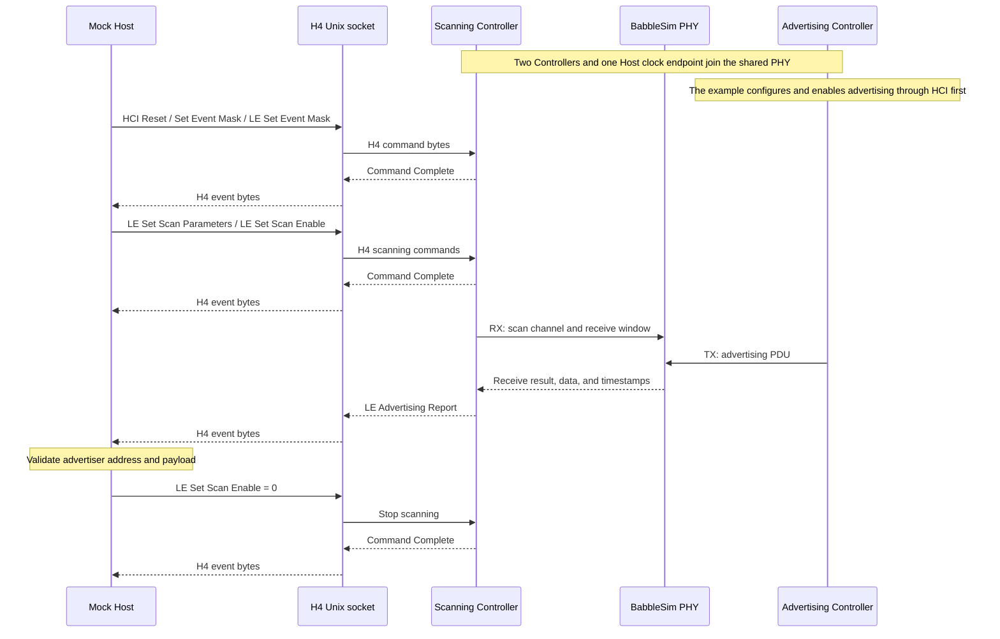

# BSController

English | [简体中文](README.zh-CN.md)

BSController is a Python Bluetooth LE Controller that can be installed, run, and published independently. Its import package and command-line entry point are both named `bscontroller`. It exposes an H4 HCI byte interface to the Host, executes LE link-layer procedures, and uses a BabbleSim PHY for radio transmission, reception, and discrete-time synchronization.

Supported features include legacy advertising, active and passive scanning, extended advertising, periodic advertising and synchronization, ACL connections, link-layer encryption, data-length negotiation, channel selection, and PHY updates across LE 1M, LE 2M, and LE Coded PHYs. Privacy, ISO, PAwR, and Bluetooth Classic are not implemented.

## Installation and execution

The module requires Python 3.11 or newer and [BabbleSim](https://babblesim.github.io/) for RF simulation, running on Linux. The following instructions use Ubuntu 24.04 x86_64. Install the build tools first:

```sh
sudo apt-get update
sudo apt-get install -y git repo build-essential gcc-multilib g++-multilib python3-venv
```

Follow the [official BabbleSim fetching instructions](https://babblesim.github.io/fetching.html) to download the sources, then build the PHY, modem, and channel needed by this module:

```sh
mkdir -p "$HOME/bsim"
cd "$HOME/bsim"
repo init -u https://github.com/BabbleSim/manifest.git -m everything.xml -b master
repo sync

export BSIM_OUT_PATH="$PWD/build"
export BSIM_COMPONENTS_PATH="$PWD/components"

make -j"$(nproc)" ext_2G4_phy_v1 ext_2G4_modem_BLE_simple ext_2G4_channel_multiatt
```

Build outputs are placed in `$BSIM_OUT_PATH/bin/` and `$BSIM_OUT_PATH/lib/`. Retain these exports when running BSController; the CLI, examples, and RF tests use `BSIM_OUT_PATH` directly. See the [official BabbleSim build instructions](https://babblesim.github.io/building.html) for more options.

After building BabbleSim, return to this module's source root and install the Python package:

```sh
python3 -m venv .venv
source .venv/bin/activate
python -m pip install .
bscontroller --help
```

## Technical architecture

Each Controller implements HCI, the Link Layer, and radio adaptation. Multiple Controllers connect to the same BabbleSim PHY and interact through shared radio channels on a common simulation timeline.

<div align="center"><br><em>Figure 1: Controller protocol architecture and shared PHY</em></div>

Protocol behavior follows [Bluetooth Core 6.3](https://www.bluetooth.com/wp-content/uploads/Files/Specification/HTML/Core_v6.3/out/en/architecture,-change-history,-and-conventions/architecture.html#UUID-37039e1f-e0cd-37ce-2cf0-15dd6e6cff2e). The specification defines the protocol boundaries between the Host, Controller, LL, and PHY; the modules below are this implementation's organization.

### Internal architecture

The following diagram expands one Controller instance. LL role managers own active contexts and their lifetimes. Each ACL connection has its own LLCP, packet-security state, and event executor; all roles share one RadioResourceManager.


*Figure 2: Controller internal architecture. [Open the SVG for detail](docs/images/radio_controller_internal_arch.svg).*

Nested boxes show object and state ownership. Black arrows denote operations/control, dashed green arrows denote Listener callbacks, orange denotes activity selection and scheduling windows, blue denotes PDUs and RF results, and dotted gray arrows denote runtime composition, driving, and clock relationships. H4Parser/H4Server describe the socket path; in-process HCI packets enter Controller directly.

| Module | Responsibilities and state ownership |
| --- | --- |
| `hci/` | H4 framing, command decoding and parameter conversion, command-family selection, unfinished HCI fragments, event masks, duplicate filtering, and report encoding |
| `linklayer/api.py`, `service.py` | Decoded configuration, read-only queries, and role commands; HCI submits `AdvertisingConfig` without radio deadlines or event counters |
| `linklayer/notifications.py`, `listener.py` | Convert committed LL state to frozen notification snapshots before passing it to HCI; active contexts remain inside LL |
| `linklayer/roles.py`, `results.py` | Own connection handles, advertising/scanning/initiating/synchronization contexts, lifetime transitions, next activities, and validated RF outcomes |
| `linklayer/connection.py` | `Connection` manages lifetime, current parameters, anchor, and supervision timeout |
| `linklayer/llcp.py`, `procedure.py` | `LlcpCoordinator` handles control admission, procedure contexts and reply association, packet-level TX/RX gates, ACK routing, and response-timer ownership |
| `linklayer/control.py`, `phy.py`, `connection_parameters.py`, `encryption.py`, `data_length.py` | Procedure-owned state transitions, collision rules, Instant updates, key/mode transitions, and data-length negotiation; PHY and connection parameters have their own handlers |
| `linklayer/connection_event.py`, `data_path.py` | `ConnectionEvent` owns the TX queue, SN/NESN, LL fragmentation, and retry snapshot; packet security, effective limits, and RX facts form its explicit contract with LLCP |
| `linklayer/primary.py`, `extended.py`, `periodic.py` | Execute role-specific packet validation and immediate exchanges, reporting connection/sync outcomes to the role owner; active contexts are defined in `discovery.py` |
| `linklayer/resource.py`, `scheduler.py` | `RadioResourceManager` supplies shared reservations, priorities, arbitration, and activity-window release; scheduling helpers find complete, non-preemptive slots |
| `radio/`, `runtime/` | Radio supplies TX/RX, physical time, and BabbleSim FIFO adaptation; Runtime composes threads, event loops, sessions, and PHY process lifecycle |

Control requests pass through the LL service to LLCP admission. Asynchronous procedures return a `PreparedProcedure`: HCI emits Command Status before calling `start()`, so immediate completion from cached information also follows Command Status. HCI queries and notifications return detached values rather than live Connection, Advertising, or PeriodicSync objects. Configuration commits preserve LL-owned event timing and counters; reading advertising TX power does not create or reconfigure a role.

Role managers prepare activities and reservations, commit validated connection/synchronization outcomes, and publish notifications after updating their resource tables. RadioLink drives these managers and the shared scheduler. Packet validation and T_IFS responses stay in the event executors; cross-role lifetime changes go through the owning manager.

Host ACL data enters the event queue through the LL service. RX facts include the prospective control ACK without consuming it. LLCP authenticates and checks admissibility before the executor commits ARQ state. Effective limits and packet-security modes are separate from procedure state; sent/ACK callbacks may change encryption inside one connection event.

Outstanding requests are removed on a matching reply or link teardown; delayed replies during an encryption pause are routed using the same association. The shared response timer records its current procedure owner, so PHY completion stops only its own timer. Public HCI connection identities are read-only, advertising payload views return `bytes`, and scan configuration reads return detached copies. Updates go through HCI commands or LL services.

HCI/LL handle raw payloads; the Host owns L2CAP reassembly, ATT/GATT, SMP pairing, and key storage. Controller-to-Controller packets all pass through the shared PHY. Resource capacities and supported PHY masks are implementation capabilities. See [Threads, clocks, and resource ownership](#threads-clocks-and-resource-ownership) for execution and cleanup order.

## Running examples

[examples/advertise_scan.py](examples/advertise_scan.py) exposes a scanning Controller through a standard H4 HCI Unix socket and implements a Mock Host that only exchanges HCI bytes over that socket. A second Controller transmits advertisements through the shared PHY, providing simulated RF input.

```sh
python examples/advertise_scan.py
```



The example exercises the Host's H4 transport boundary, HCI command processing, and PHY advertising reception path. See [examples/README.md](examples/README.md) for details.

Expose H4 HCI to an external Host:

```sh
bscontroller serve --hci-socket /tmp/radio.sock --btsnoop-file /tmp/hci.snoop
```

Use `hci_snoop_file=Path(...)` when constructing `RadioController`, or `--btsnoop-file` with the CLI, to write a BTSnoop v1 H4 capture. The worker records complete HCI packets with its local simulation timestamps before handing output to the Host loop. Records are written without user-space buffering; capture does not advance simulation time. BSWorld supplies this path automatically.

The Host exchanges an H4 HCI byte stream over the Unix socket. The service accepts one Host and exits when it disconnects; the socket path must be unused. See `bscontroller serve --help` for more options.

## Threads, clocks, and resource ownership

Create `RadioController` inside the Host's running event loop; it runs its Controller in a dedicated thread. The Host and the worker never share mutable protocol state, so Host input and Controller output are passed as immutable H4 packets.

RF time uses integer microseconds. Each worker keeps its own clock endpoint and synchronizes with the shared simulation timeline through the PHY. A standalone Host may use an additional clock endpoint, which needs a PHY device identity distinct from every Controller.

| Object | Resources it manages |
| --- | --- |
| `RadioController` | One worker thread, Controller event loop, and radio FIFO endpoint |
| `RadioSession` | Worker startup and shutdown, plus an optional standalone Host clock connection and loop binding |
| `H4Server` | Unix socket, one Host connection, H4 framing, and a bounded output queue |
| `PhyProcess` | BabbleSim PHY subprocess, logs, and simulation directory cleanup |

`RadioSession` connects to an already running PHY; it does not start that process. With `clock_dev_id`, the Host must use `RadioEventLoop`. Without it, the caller supplies a synchronized clock and event loop and owns device identities, startup barriers, and time binding. Stop workers before closing the Host clock and PHY. The CLI and example already combine these lifecycles.

## Python integration

Public exports include `RadioController`, `RadioSession`, `RadioEventLoop`, `Radio`, `Phy`, `Received`, and `hci`. For a direct connection, send complete H4 packets with `controller.on_packet(packet)` and register an output sink with `controller.set_packet_sink(sink)` before starting the worker. The sink must implement `on_packet(packet: bytes)`.

For an external Host, pass `hci_socket` to `RadioController`. The worker owns socket reads, H4 parsing, and replies in its Controller thread. Startup returns once the socket is listening; commands wait until the worker has received its initial PHY grant at time zero and bound its clock. Socket mode does not use the cross-thread packet queue or HCI polling timer.

This example joins a PHY already started by the caller. The PHY must use the same `sim_id` and have two devices: identity `0` for the Controller and `1` for the Host clock.

```python
import asyncio
from pathlib import Path

from bscontroller import RadioController, RadioEventLoop, RadioSession


async def main():
    controller = RadioController(
        "controller", "F0:F1:F2:F3:F4:01", hci_socket=Path("/tmp/radio.sock")
    )
    async with RadioSession("example", [(0, controller)], clock_dev_id=1):
        await controller.terminated


with asyncio.Runner(loop_factory=RadioEventLoop) as runner:
    runner.run(main())
```

## Layout and verification

```text
.
├── pyproject.toml
├── src/bscontroller/     # Runtime package (public API, HCI, Link Layer, radio, runtime)
├── examples/             # Runnable H4 Controller and Mock Host example
└── tests/
    ├── unit/             # Self-contained implementation checks (no native PHY)
    └── qualification/    # HCI/LL protocol cases (RF cases need BabbleSim)
```

```sh
python -m pip install -e '.[test]'
python -m pytest tests/unit -n auto --dist worksteal -q
python -m pytest tests/qualification -n auto --dist worksteal -v -rs
python -m build
```

The protocol suite contains 501 selected HCI/LL cases, retaining distinct `PASS`, `PARTIAL`, source-conflict skips, and applicability skips. Timing-limited cases use their documented integer-microsecond approximation. These results are not a Bluetooth qualification claim. See [tests/README.md](tests/README.md) for test scope and execution details.

Build artifacts are written to `dist/`. The source distribution includes the runtime, examples, and unit and protocol tests; the wheel contains the runtime and required license notices. See [LICENSE](LICENSE) and [NOTICE](NOTICE) for licensing and third-party attribution.
