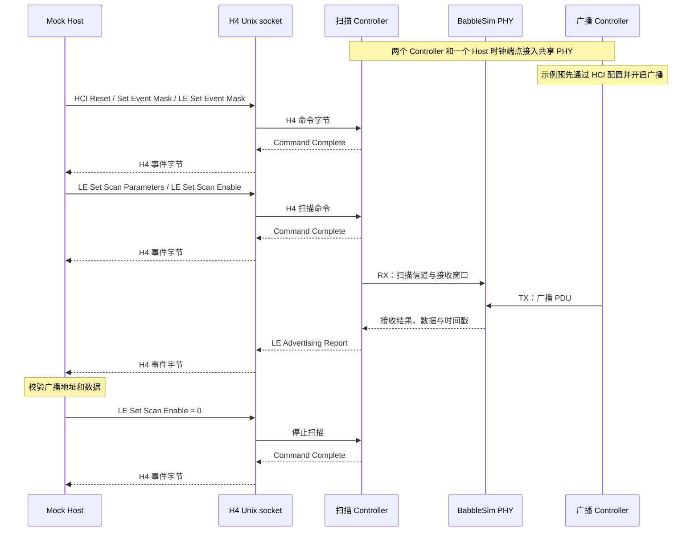

# BSController

[English](README.md) | 简体中文

BSController 是可独立安装、运行和发布的 Python Bluetooth LE Controller，Python 导入包为 `bscontroller`，命令行入口为 `bscontroller`。它向 Host 提供 H4 HCI 字节接口，在内部执行 LE 链路层过程，并通过 BabbleSim PHY 完成射频收发与离散时间同步。

支持传统广播、主动及被动扫描、扩展广播、周期广播与同步、ACL 连接、链路层加密、数据长度协商、信道选择及 PHY 更新，覆盖 LE 1M、LE 2M 和 LE Coded PHY。当前不实现 Privacy、ISO、PAwR 和 Bluetooth Classic。

## 安装与运行

本模块依赖 Python 3.11 或更新版本，以及 [BabbleSim](https://babblesim.github.io/) 提供的射频仿真环境，运行于 Linux。以下以 Ubuntu 24.04 x86_64 为例，先安装构建工具：

```sh
sudo apt-get update
sudo apt-get install -y git repo build-essential gcc-multilib g++-multilib python3-venv
```

按 [BabbleSim 官方获取说明](https://babblesim.github.io/fetching.html) 下载源码，并编译本模块需要的 PHY、modem 和 channel：

```sh
mkdir -p "$HOME/bsim"
cd "$HOME/bsim"
repo init -u https://github.com/BabbleSim/manifest.git -m everything.xml -b master
repo sync

export BSIM_OUT_PATH="$PWD/build"
export BSIM_COMPONENTS_PATH="$PWD/components"

make -j"$(nproc)" ext_2G4_phy_v1 ext_2G4_modem_BLE_simple ext_2G4_channel_multiatt
```

构建产物位于 `$BSIM_OUT_PATH/bin/` 和 `$BSIM_OUT_PATH/lib/`。运行 BSController 时保留上述环境变量，命令行、示例和 RF 测试直接使用 `BSIM_OUT_PATH`。更多构建选项见 [BabbleSim 官方编译说明](https://babblesim.github.io/building.html)。

编译完成后，回到本模块的源码根目录安装 Python 包：

```sh
python3 -m venv .venv
source .venv/bin/activate
python -m pip install .
bscontroller --help
```

## 技术架构

每个 Controller 实现 HCI、Link Layer 和射频适配。多个 Controller 连接同一个 BabbleSim PHY，在共享信道和共同的仿真时间线上进行射频交互。

<div align="center"><br><em>图 1：Controller 协议架构与共享 PHY</em></div>

协议行为遵循 Bluetooth Core 6.3。与集成和调试相关的分层方式、命令与事件流以及实现限制，见[架构概览](docs/architecture.zh-CN.md)。

## 运行示例

[examples/advertise_scan.py](examples/advertise_scan.py) 将扫描 Controller 暴露为标准 H4 HCI Unix socket，并实现一个仅通过 socket 收发 HCI 字节的 Mock Host。另一个 Controller 通过共享 PHY 发送广播，提供经过 PHY 传播的仿真射频输入。

```sh
python examples/advertise_scan.py
```



该示例同时验证 Host 的 H4 传输边界、HCI 命令处理以及 PHY 广播接收路径。更多说明见 [examples/README.zh-CN.md](examples/README.zh-CN.md)。

向外部 Host 提供 H4 HCI 服务：

```sh
bscontroller serve --hci-socket /tmp/radio.sock --btsnoop-file /tmp/hci.snoop
```

构造 `RadioController` 时使用 `hci_snoop_file=Path(...)`，或在 CLI 中使用 `--btsnoop-file`，可写入 BTSnoop v1 H4 抓包文件。worker 会在将输出交给 Host event loop 前，使用本地仿真时间戳记录完整的 HCI 报文。记录不经用户态缓冲直接写入；抓包不会推进仿真时间。BSWorld 会自动提供该路径。

Host 通过 Unix socket 收发 H4 HCI 字节流。服务接受一个 Host，Host 断开后退出；socket 路径必须尚未被占用。更多选项见 `bscontroller serve --help`。

## 线程、时钟与资源生命周期

`RadioController` 需在 Host 的运行中事件循环内创建，它会在独立线程中运行 Controller。Host 与 worker 不共享可变协议状态，两侧以不可变 H4 字节包交换数据。

射频时间以整数微秒表示。每个 worker 维护自己的时钟端点，通过 PHY 同步到共同的仿真时间线。独立 Host 可以使用额外的时钟端点，其 PHY 设备编号需与所有 Controller 区分开。

| 对象 | 管理的资源 |
| --- | --- |
| `RadioController` | 单个 worker 线程、Controller 事件循环及射频 FIFO 端点 |
| `RadioSession` | worker 启停，以及可选的独立 Host 时钟连接和事件循环绑定 |
| `H4Server` | Unix socket、单个 Host 连接、H4 分帧和有界输出队列 |
| `PhyProcess` | BabbleSim PHY 子进程、日志及仿真目录清理 |

`RadioSession` 连接已经启动的 PHY，不负责启动 PHY 进程。指定 `clock_dev_id` 时，Host 需要使用 `RadioEventLoop`；省略该参数时，由调用方提供已同步的时钟和事件循环，并负责设备编号、启动屏障及时间绑定。释放资源时先停止 worker，再关闭 Host 时钟和 PHY。命令行和示例已经组合这些生命周期。

## Python 接入

公开入口包括 `RadioController`、`RadioSession`、`RadioEventLoop`、`Radio`、`Phy`、`Received` 和 `hci`。直接接入时，调用 `controller.on_packet(packet)` 发送完整的 H4 包，并在启动 worker 之前使用 `controller.set_packet_sink(sink)` 注册输出接收器；接收器需实现 `on_packet(packet: bytes)`。

外部 Host 接入时，向 `RadioController` 传入 `hci_socket`。worker 在 Controller 线程内完成 socket 读写、H4 解析与回复。启动在 socket 开始监听后返回；HCI 命令会等到零时刻的 PHY 同步完成并绑定时钟后才处理。socket 模式不使用跨线程报文队列和 HCI 轮询定时器。

以下示例连接已由调用方启动的 PHY。PHY 使用相同的 `sim_id`，配置两个设备，设备编号 `0` 为 Controller，`1` 为 Host 时钟：

```python
import asyncio
from pathlib import Path

from bscontroller import RadioController, RadioEventLoop, RadioSession


async def main():
    controller = RadioController(
        "controller", "F0:F1:F2:F3:F4:01", hci_socket=Path("/tmp/radio.sock")
    )
    async with RadioSession("example", [(0, controller)], clock_dev_id=1):
        await controller.terminated


with asyncio.Runner(loop_factory=RadioEventLoop) as runner:
    runner.run(main())
```

## 目录与验证

```text
.
├── pyproject.toml
├── src/bscontroller/     # 运行时包（公开 API、HCI、Link Layer、radio、runtime）
├── examples/             # 可运行的 H4 Controller 与 Mock Host 示例
└── tests/
    ├── unit/             # 自包含的实现检查（无需原生 PHY）
    └── qualification/    # HCI/LL 协议用例（RF 用例需要 BabbleSim）
```

```sh
python -m pip install -e '.[test]'
python -m pytest tests/unit -n auto --dist worksteal -q
python -m pytest tests/qualification -n auto --dist worksteal -v -rs
python -m build
```

协议测试包含 501 个选定 HCI/LL 用例，结果保留 `PASS`、`PARTIAL`、规范冲突跳过和不适用跳过的区别；受时间精度限制的用例使用各自注明的整数微秒近似，不代表正式蓝牙认证。测试范围和执行方式见 [tests/README.zh-CN.md](tests/README.zh-CN.md)。

构建产物位于 `dist/`。源码发行包包含运行时、示例及单元和协议测试；wheel 包含运行时与必要版权声明。许可证及第三方归属见 [LICENSE](LICENSE) 和 [NOTICE](NOTICE)。
