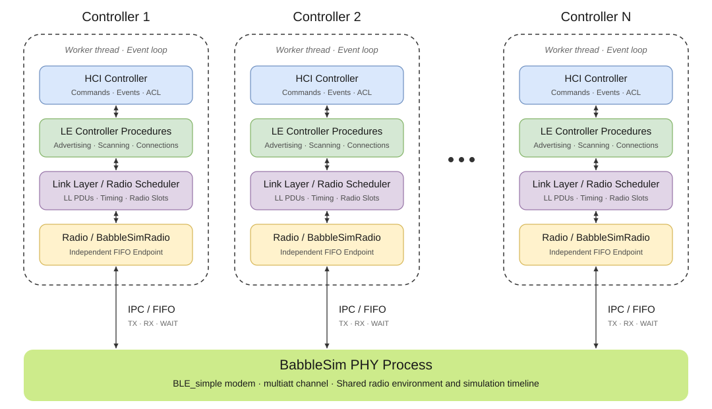
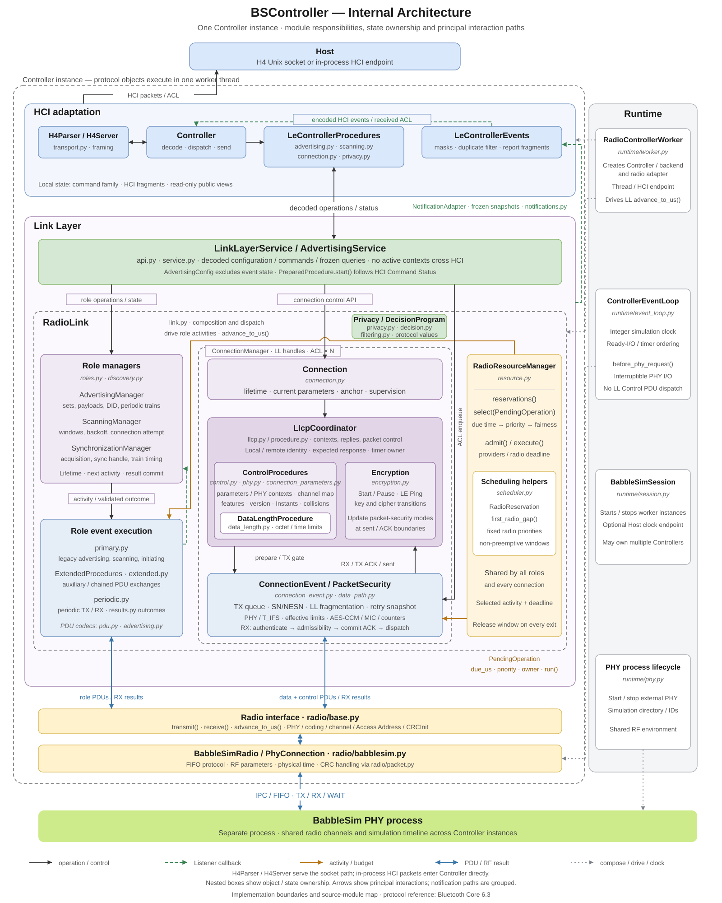

# BSController

[English](README.md) | 简体中文

BSController 是用 Python 实现的低功耗蓝牙 Controller。你的 Host 协议栈通过标准 H4 HCI 和它通信，它通过模拟射频（[BabbleSim](https://babblesim.github.io/)）收发数据。同一模拟射频上的 Controller 之间可以互相通信。仿真时间是离散的，运行结果可复现。

## 快速开始

BSController 需要 Linux、Python 3.11 或更高版本，以及编译好的 BabbleSim。以 Ubuntu 24.04 x86_64 为例，先安装构建工具：

```sh
sudo apt-get update
sudo apt-get install -y git repo build-essential gcc-multilib g++-multilib python3-venv
```

获取 BabbleSim 并编译其 PHY、调制解调器和信道模型：

```sh
mkdir -p "$HOME/bsim" && cd "$HOME/bsim"
repo init -u https://github.com/BabbleSim/manifest.git -m everything.xml -b master
repo sync
export BSIM_OUT_PATH="$PWD/build"
export BSIM_COMPONENTS_PATH="$PWD/components"
make -j"$(nproc)" ext_2G4_phy_v1 ext_2G4_modem_BLE_simple ext_2G4_channel_multiatt
```

运行 BSController 时需要保持 `BSIM_OUT_PATH` 环境变量。其他编译选项见 BabbleSim 的[获取](https://babblesim.github.io/fetching.html)和[编译](https://babblesim.github.io/building.html)指南。

然后在本目录下安装 BSController：

```sh
python3 -m venv .venv
source .venv/bin/activate
python -m pip install .
```

## 独立运行 Controller

启动一个 Controller，再让你的 Host 连接它的 socket：

```sh
bscontroller serve --hci-socket /tmp/radio.sock --btsnoop-file /tmp/hci.snoop
```

`serve` 会启动一个 BabbleSim PHY，并在 Unix socket 上提供 H4 HCI。它只接受一个 Host，Host 断开后退出；socket 路径不能已存在。`--btsnoop-file` 保存 HCI 报文，可用 Wireshark 打开。见 `bscontroller serve --help`。

Controller 按仿真时间运行，仿真时间会以机器允许的最快速度推进。使用墙钟时间的 Host 会看到 Controller 跑在前面，两边的定时器和超时对不上。

要得到可复现的结果，Host 需要接入同一个离散时间调度。如果只是手动快速测试，可以加上 BabbleSim 的刹车设备 handbrake，它让仿真时间与墙钟时间保持接近。先多分配一个设备启动 PHY，再让 BSController 加入：

```sh
cd "$BSIM_OUT_PATH/bin"
./bs_2G4_phy_v1 -s=demo -D=3 &           # 0：Controller，1：serve 时钟，2：handbrake
./bs_device_handbrake -s=demo -d=2 -r=1 &  # -r：仿真时间与墙钟时间之比
bscontroller serve --join --sim-id demo --dev-id 0 --clock-id 1 \
  --hci-socket /tmp/radio.sock --btsnoop-file /tmp/hci.snoop
```

此时时序仍会受主机负载影响，只适合探索性测试。

## 在 Python 中使用

`RadioController` 在独立的 worker 线程中运行一个 Controller，必须在正在运行的 asyncio 事件循环里创建它。`RadioSession` 把它接入一个已经启动的 PHY。下面的示例要求 PHY 已用相同的 `sim_id`（`example`）启动，并且有两个设备：设备 `0` 给 Controller，设备 `1` 给 Host 时钟。

```python
import asyncio
from pathlib import Path

from bscontroller import RadioController, RadioEventLoop, RadioSession


async def main():
    controller = RadioController(
        "controller", "F0:F1:F2:F3:F4:01", hci_socket=Path("/tmp/radio.sock")
    )
    async with RadioSession("example", [(0, controller)], clock_dev_id=1):
        await controller.terminated


with asyncio.Runner(loop_factory=RadioEventLoop) as runner:
    runner.run(main())
```

[examples/advertise_scan.py](examples/advertise_scan.py) 是基于这些接口的完整程序：用 `PhyProcess` 启动 PHY，在一个 `RadioSession` 中运行一个广播 Controller 和一个扫描 Controller，模拟 Host 通过扫描端的 socket 完成扫描。运行 `python examples/advertise_scan.py`，详见 [examples/README.zh-CN.md](examples/README.zh-CN.md)。

Host 有两种接入方式：

- **Socket 方式**：像上面的示例一样传入 `hci_socket`，任何支持基于 Unix socket 的 H4 的 Host 都能连接。socket 开始监听后启动就会返回，Controller 与 PHY 完成同步后才开始处理 HCI 命令。
- **进程内方式**：不传 `hci_socket`。启动之前，先用 `controller.set_packet_sink(sink)` 注册一个实现了 `on_packet(packet: bytes)` 方法的对象，之后用 `controller.on_packet(packet)` 发送完整的 H4 报文。

传入 `hci_snoop_file=Path(...)` 可以录制 BTSnoop 抓包，时间戳使用仿真时间。

其他公开接口有：`ControllerConfig`（见[配置](#配置)）、`RadioEventLoop`、`Radio`、`Phy`、`Received` 和 `hci`（HCI 报文类）。

自行管理运行时时：

- `RadioSession` 不启动 PHY，可用 `bscontroller.runtime.PhyProcess` 启动。
- 传入 `clock_dev_id` 时，Host 事件循环必须是 `RadioEventLoop`；不传时，需自行提供时钟，并为每个参与者分配不同的 PHY 设备编号。
- 先停止 Controller，再关闭 Host 时钟和 PHY；`async with RadioSession(...)` 会按此顺序处理。

## 配置

蓝牙规范交由 Controller 决定的值组成一个 `ControllerConfig`，未设置的字段使用默认值。

| JSON 键 | 默认值 | 范围 | 规范章节（Vol 4, Part E） |
|---|---|---|---|
| `hciVersion` | `0x0F` (6.1) | `0x06`–`0x10` | 7.4.1 |
| `hciRevision` | `0` | `0`–`0xFFFF` | 7.4.1 |
| `lmpVersion` | `0x0F` (6.1) | `0x06`–`0x10` | 7.4.1 |
| `lmpSubversion` | `0` | `0`–`0xFFFF` | 7.4.1 |
| `manufacturer` | `0xFFFF` | `0`–`0xFFFF` | 7.4.1 |
| `aclPacketCount` | `8` | `1`–`255` | 7.8.2 |
| `aclPacketLength` | `251` | `27`–`65535` | 7.8.2 |
| `maxTxOctets` | `251` | `27`–`251` | 7.8.46 |
| `maxTxTime` | `17040` | `328`–`17040` | 7.8.46 |
| `maxRxOctets` | `251` | `27`–`251` | 7.8.46 |
| `maxRxTime` | `17040` | `328`–`17040` | 7.8.46 |
| `advertisingSetCount` | `16` | `1`–`240` | 7.8.58 |
| `maxAdvertisingDataLength` | `1650` | `31`–`1650` | 7.8.57 |
| `filterAcceptListSize` | `16` | `1`–`255` | 7.8.14 |
| `resolvingListSize` | `16` | `1`–`255` | 7.8.41 |
| `periodicAdvertiserListSize` | `8` | `1`–`255` | 7.8.73 |
| `maxConnections` | `64` | `1`–`3839` | 5.3.1 |
| `maxPeriodicSyncs` | `16` | `1`–`3839` | 5.3.1 |

配置文件包含两部分：`defaults` 对所有 Controller 生效；`controllers` 按 Controller 名称分别设置：

```json
{
  "defaults": {"aclPacketCount": 16},
  "controllers": {"hci0": {"maxConnections": 2}, "hci1": {"maxTxOctets": 27}}
}
```

键名使用 camelCase，也接受 snake_case。同一个值按越具体越优先的顺序生效：内置默认值，然后是 `defaults`，然后是 `controllers.<name>`，最后是 Python 关键字参数。未知的键或超出范围的值会被跳过并输出 warning，该字段保持原来的值，文件中的其他设置照常生效。

命令行用法：

```sh
bscontroller config > bsc.json        # 导出全部默认值，在此基础上修改
bscontroller serve --hci-socket /tmp/radio.sock --config bsc.json --name hci0
```

Python 中，把配置文件（或同样结构的 dict）传给 `RadioController`，每个 Controller 会按自己的名字选用 `controllers` 中的条目：

```python
from bscontroller import ControllerConfig, RadioController

central = RadioController("hci0", "F0:F1:F2:F3:F4:01", config="bsc.json")
peripheral = RadioController("hci1", "F0:F1:F2:F3:F4:02", config="bsc.json")
other = RadioController("x", "F0:F1:F2:F3:F4:03", config=ControllerConfig(max_connections=2))
```

`ControllerConfig(...)` 遇到非法值会抛出 `ValueError`。

## 支持的特性

下表按首次引入的版本，列出蓝牙 Core 规范中的 Link Layer 特性。`*` 标记已实现的特性。有已分配 Link Layer 特性位的能力会在 LE FeatureSet（[Vol 6, Part B, 4.6](https://www.bluetooth.com/wp-content/uploads/Files/Specification/HTML/Core_v6.3/out/en/low-energy-controller/link-layer-specification.html#UUID-56ada5ed-4ae3-acee-198f-27ead57d86f1)）中声明。不支持经典蓝牙（BR/EDR）。

| Core 规范版本 | Link Layer 特性 | 支持 |
|---|---|:---:|
| 4.0 | LE Encryption | * |
| 4.1 | Connection Parameters Request Procedure | * |
| 4.1 | Extended Reject Indication | * |
| 4.1 | Peripheral-initiated Features Exchange | * |
| 4.1 | LE Ping Procedure | * |
| 4.2 | LE Data Packet Length Extension | * |
| 4.2 | LL Privacy | * |
| 4.2 | Extended Scanner Filter Policies | * |
| 5.0 | LE 2M PHY | * |
| 5.0 | LE Coded PHY | * |
| 5.0 | Channel Selection Algorithm #2 | * |
| 5.0 | Minimum Number of Used Channels Procedure | * |
| 5.0 | Extended Advertising | * |
| 5.0 | Periodic Advertising | * |
| 5.1 | Connection CTE Request |  |
| 5.1 | Connection CTE Response |  |
| 5.1 | Connectionless CTE Transmitter |  |
| 5.1 | Connectionless CTE Receiver |  |
| 5.1 | Periodic Advertising Sync Transfer |  |
| 5.1 | Initiating Periodic Advertising Sync Transfer for Local Periodic Advertising |  |
| 5.1 | Initiating Periodic Advertising Sync Transfer for Remote Periodic Advertising |  |
| 5.2 | Isochronous Broadcaster |  |
| 5.2 | Synchronized Receiver |  |
| 5.2 | Connected Isochronous Stream (CIS) |  |
| 5.3 | Periodic Advertising ADI Support |  |
| 5.3 | LE Channel Classification |  |
| 5.3 | Connection Subrating |  |
| 5.4 | Periodic Advertising with Responses |  |
| 6.0 | Channel Sounding |  |
| 6.0 | Decision-Based Advertising Filtering | * |
| 6.0 | Monitoring Advertisers |  |
| 6.0 | Frame Space Update |  |
| 6.1 | Randomized RPA Updates | * |
| 6.2 | Shorter Connection Intervals |  |
| 6.2 | Channel Sounding Amplitude-based Attack Resilience |  |
| 6.3 | Channel Sounding Inline Phase Correction Term Transfer |  |

## 工作原理

每个 Controller 由 HCI 层、Link Layer 和射频适配层组成。所有 Controller 都连接到同一个 BabbleSim PHY，PHY 负责在共享信道上传递它们的报文，并推进统一的仿真时钟。协议行为遵循 [Bluetooth Core 6.3](https://www.bluetooth.com/wp-content/uploads/Files/Specification/HTML/Core_v6.3/out/en/architecture,-change-history,-and-conventions/architecture.html#UUID-37039e1f-e0cd-37ce-2cf0-15dd6e6cff2e)。

<div align="center"><br><em>图 1：共享同一 PHY 的多个 Controller</em></div>

在单个 Controller 内部，Link Layer 为每种角色（广播、扫描、发起连接、同步、连接）各维护一个管理器。每条 ACL 连接都有自己的控制流程状态、加密状态和连接事件执行器。所有角色共用一个射频调度器，由它决定这唯一的一个射频下一步做什么。



*图 2：单个 Controller 内部结构。嵌套框表示归属关系；黑色箭头是调用，绿色虚线是回调，橙色是调度，蓝色是 PDU 和射频结果，灰色点线是运行时的组装关系。*

**线程与时间。** 每个 `RadioController` 运行在独立线程中，有自己的事件循环和 PHY 连接。Host 线程和 Controller 线程之间不共享任何状态，只传递不可变的 H4 报文。射频时间以整数微秒计。每个 Controller，以及可选的 Host 时钟，都要先与 PHY 同步，仿真时间才会推进，所以时序与机器快慢无关。

| 对象 | 负责的资源 |
| --- | --- |
| `RadioController` | worker 线程、Controller 事件循环、射频连接 |
| `RadioSession` | 启动和停止 worker，可选的 Host 时钟 |
| `H4Server` | Unix socket、Host 连接、H4 分帧 |
| `PhyProcess` | BabbleSim PHY 进程及其日志和仿真目录 |

## 开发

```text
.
├── src/bscontroller/     # 包：HCI、Link Layer、射频、运行时、配置
├── examples/             # 可直接运行的双 Controller 示例，带模拟 Host
└── tests/
    ├── unit/             # 快速测试，不需要 PHY
    └── qualification/    # HCI/LL 协议用例；射频用例需要 BabbleSim
```

```sh
python -m pip install -e '.[test]'
python -m pytest tests/unit -n auto -q                  # 约 3 秒
python -m pytest tests/qualification -n auto -v -rs     # 几分钟，需要 BSIM_OUT_PATH
python -m build                                         # 在 dist/ 生成 sdist 和 wheel
```

qualification 测试从蓝牙测试规范中选取了 612 个 HCI 和 Link Layer 用例，由独立实现的 Lower Tester 执行。通过这些用例不代表 BSController 已通过蓝牙认证。测试范围见 [tests/README.zh-CN.md](tests/README.zh-CN.md)。

许可证和第三方声明见 [LICENSE](LICENSE) 和 [NOTICE](NOTICE)。
