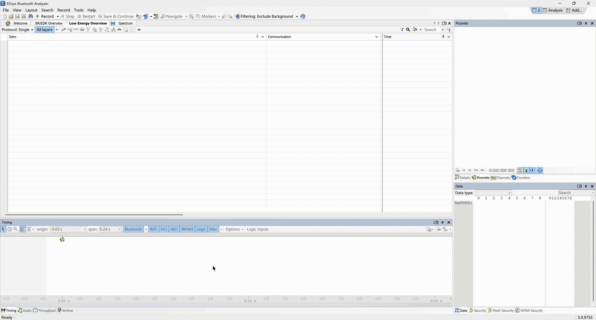

# 日志、跟踪文件与抓包

[English](../artifacts.md) | [简体中文](artifacts.md)

BSWorld 会为每个测试保存框架日志、业务程序日志、HCI 抓包和 RF 空口跟踪文件。这些文件不仅用于查看测试输出，也用于把一次失败还原到业务程序、Host、Controller 和无线链路中的具体位置。

## 输出目录与测试隔离

测试会话启动时，框架会打印本次运行的输出目录：

```text
[bsworld] log dir: /tmp/run-<timestamp>/<uid>
```

默认根目录是 `/tmp`。可以通过命令行参数或环境变量修改：

```sh
pytest tests/ --out-dir=/path/to/artifacts
OUT_DIR=/path/to/artifacts pytest tests/
```

框架会在指定根目录下继续创建 `run-<timestamp>/<uid>`。同一次 pytest 会话中的 [pytest-xdist](https://pytest-xdist.readthedocs.io/) worker 共享这个会话目录，但每个测试按照 pytest node ID 写入独立子目录，因此并行测试不会覆盖彼此的日志、socket 或抓包文件。

## Docker 与 CI 结果

[Docker 命令](../../docker/README.zh-CN.md#运行测试)将 `/output` 挂载到主机的 `.cache/docker-results`。镜像默认命令在其中保存 `pytest.xml`，各测试的日志和抓包文件保存在同级的 `run-<timestamp>/<uid>` 目录下。

在 GitHub Actions 中，打开 **Actions → CI → 对应运行记录**，可查看 `Build runtime image`，以及独立的 `Lint`、`Unit tests`、`Integration tests`，全部检查均在构建出的镜像内执行。每个检查 job 单独上传 `bsworld-results-<job>-<run-id>-<attempt>` 附件，`<job>` 分别为 `lint`、`unit`、`integration`。单元测试附件包含 `unit.xml`、终端日志和 `unit/` 下的测试产物；集成测试附件包含 `integration.xml`、日志、抓包和 `integration/` 下的测试产物；静态检查附件包含 `ruff.log`。如果已构建镜像，集成测试附件还包含镜像标签和信息。失败时也会上传报告与日志，保留 14 天。

通过 `latest`、源码提交或 Release tag 选择镜像，见 [Docker 使用说明](../../docker/README.zh-CN.md#使用已发布镜像)。

## 目录结构

下面是一项 NuttX 扫描测试的典型目录：

```text
/tmp/run-<timestamp>/<uid>/
    log/
        tests/
            integration/
                nuttx/
                    btsak/
                        test_btsak_scan_advertise/
                            test_nuttx_btsak_scanner_finds_advertiser/
                                bsworld.log
                                babblesim/
                                    bs_2G4_phy_v1.log
                                    ellisys.bttrp
                                    att_matrix.txt
                                    timed_att_0_1_0.txt
                                bt_virt_controller/
                                    bt_virt_controller_hci0.log
                                    bt_virt_controller_hci1.log
                                nuttx/
                                    scanners/
                                        nuttx_btsak_scanner/
                                            nuttx_btsak_scanner.log
                                            hci0.snoop
                                    advertisers/
                                        nuttx_btsak_advertiser/
                                            nuttx_btsak_advertiser.log
                                            hci1.snoop
```

`att_matrix.txt` 和 `timed_att_*.txt` 只在测试配置了对应的固定或时变路径衰减时生成。

## 各类产物

| 文件 | 生成者 | 主要内容 |
|---|---|---|
| `bsworld.log` | BSWorld | 进程命令、工作目录、PID、socket 与设备锁就绪状态、清理过程、Ellisys 转换命令和框架告警。 |
| `babblesim/bs_2G4_phy_v1.log` | BabbleSim PHY | PHY 进程的标准输出和标准错误。正常运行时可能为空。 |
| `bt_virt_controller/*.log` | 虚拟 Controller | Controller 启动信息、断言和内部诊断。 |
| `<业务程序>/<名称>.log` | 业务程序 | 业务程序合并后的标准输出和标准错误，也是 `wait_log()` 的数据来源。 |
| `<业务程序>/hciN.snoop` | Controller BTSnoop 文件 | Host 与对应虚拟 Controller 之间的 HCI 命令、事件和 ACL 数据。 |
| `babblesim/ellisys.bttrp` | BSWorld Python 转换工具 | 同一个 PHY 中所有虚拟设备的 Bluetooth LE 空口交互。 |
| `babblesim/att_matrix.txt` | BSWorld | 本测试实际传给 `multiatt` 信道模型的静态路径衰减矩阵。 |
| `babblesim/timed_att_*.txt` | BSWorld | 时变路径的时间点和衰减值。 |

`bsworld.log` 中方括号开头的时间是 Linux 墙钟时间，用于判断进程启动和清理在主机上花费了多久。业务程序日志中的仿真时间戳由对应运行环境生成，表示离散仿真时间。两者用途不同，不应直接相减来计算协议时延。

## 业务程序日志与 `wait_log()`

每个业务程序的标准输出和标准错误都写入其 `.log` 文件，并以完整行的形式提供给 `ProcessInstance.wait_log()` 使用。

```python
await device.wait_log(r"Bluetooth initialized", timeout=30)
```

`wait_log()` 有以下语义：

- 使用正则表达式逐行匹配。
- `timeout` 使用当前 event loop 的时间；拓扑启动完成后，它表示仿真时间，而不是墙钟时间。
- 已经到达 FIFO、但尚未被前一次等待消费的完整行仍然可以匹配，因此调用 `wait_log()` 前输出的日志不会自然丢失。
- 后续等待不能再次匹配已经被前一次等待越过的行。
- 没有换行符的末尾片段会立即写入 `.log` 文件，但只有收到换行符、形成完整一行后才会参与匹配。

运行过程中可以直接查看业务程序日志：

```sh
tail -f /tmp/run-<timestamp>/<uid>/log/tests/.../nuttx_btsak_advertiser.log
```

## 框架日志

每个测试只有一个 `bsworld.log`。它从 `topo.start()` 开始记录该测试的框架活动，重点包括：

- BabbleSim 实例标识和设备数量。
- PHY、虚拟 Controller 和业务程序的完整启动命令。
- 每个进程的工作目录、日志路径和 PID。
- Controller HCI socket 和 BabbleSim 设备锁的启动屏障。
- teardown 时仍在运行的进程及其清理顺序。
- Ellisys 转换使用的输入文件和输出位置。

如果进程在 teardown 前以非零状态退出，框架会在这里记录告警，并附上该进程日志的末尾内容。

## HCI BTSnoop 抓包

每个 Controller 在自身收发边界记录 HCI 报文，时间戳采用仿真时间。文件保持 BTSnoop v1、H4 链路类型 1002、完整报文长度和方向标记。

可以使用 [Wireshark](https://www.wireshark.org/) 或 `btmon` 查看：

```sh
wireshark /tmp/run-<timestamp>/<uid>/log/tests/.../hci1.snoop
btmon -r /tmp/run-<timestamp>/<uid>/log/tests/.../hci1.snoop
```

两种 Controller 的 HCI 抓包默认始终开启。绑定业务程序的 Controller 将抓包保存在业务程序目录，否则保存在 `bt_virt_controller/` 或 `bscontroller/` 下。两种实现的无线交互均记录在共享的 `ellisys.bttrp` 中。

## Ellisys 空口跟踪文件

BabbleSim PHY 会在运行过程中生成每个 RF 设备的 CSV dump。teardown 阶段，BSWorld 在 Python 进程内转换并合并发送记录，生成 `babblesim/ellisys.bttrp`，然后删除临时 BabbleSim state、socket 和原始 results 目录。

在 [Ellisys](https://www.ellisys.com/products/bex400/) 软件中打开跟踪文件：选择 **File > Import**，选择 **Bluetooth packets**，点击 **Next**，再点击 **Browse** 并选择测试目录中的 `ellisys.bttrp` 文件。

<p align="center">
  
  <br>
  <sub>将 <code>babblesim/ellisys.bttrp</code> 导入 Ellisys，用于查看 Bluetooth LE 空口报文。</sub>
</p>

`.bttrp` 展示的是 PHY 侧空口活动，适合判断：

- 广播或连接数据是否真正发送。
- 接收方所在信道和时间是否匹配。
- 路径衰减或干扰是否导致丢包。
- 多个设备的无线事件是否发生碰撞。

PHY dump 与 Ellisys 转换默认始终开启。

## 失败排查顺序

建议按照数据路径从上到下排查：

1. 查看 `bsworld.log`，确认所有进程命令、HCI socket 和设备锁是否正常，是否有进程提前退出。
2. 查看业务程序日志，确认业务状态机停在哪一步，以及 `wait_log()` 等待的文本是否真实出现。
3. 查看虚拟 Controller 日志和 `hciN.snoop`，确认 Host 是否发送预期命令、Controller 是否返回预期事件。
4. 查看 `ellisys.bttrp`，确认报文是否进入 RF 环境，以及接收失败是否来自衰减、干扰或碰撞。
5. RF 场景不符合预期时，对照 `att_matrix.txt` 和 `timed_att_*.txt` 检查实际设备编号、方向和生效时间。

这些文件在测试结束后保留在输出目录中。BSWorld 只删除 `/tmp/bs_*` 下的运行时 socket/state 和 BabbleSim 原始 results，不会自动删除每个测试的日志与抓包。
