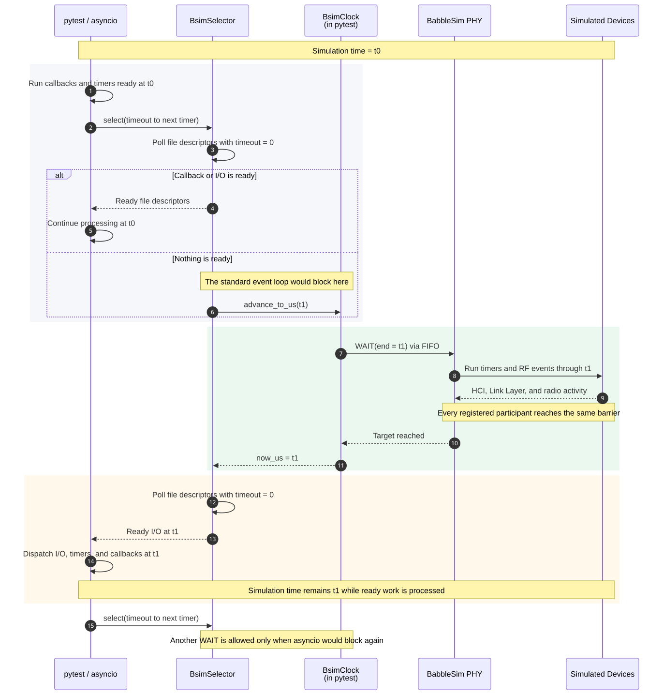
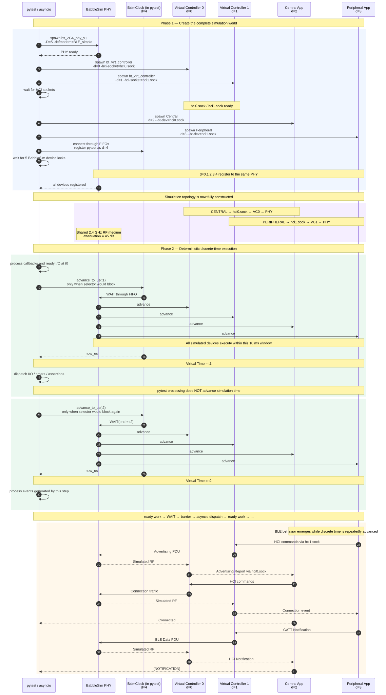

# 编写测试

[English](../writing-tests.md) | [简体中文](writing-tests.md)

仓库 [README](README.md#技术架构) 已经介绍了虚拟 Controller 和离散时间调度。本文按照测试的实际编写过程，说明如何声明拓扑、接入业务程序、使用 asyncio 执行与等待、配置 RF 场景，并验证预期的 Bluetooth LE 行为。

## 快速索引

- [测试生命周期](#测试生命周期)
- [选择 Controller](#选择-controller)
- [异步等待与仿真时间](#异步等待与仿真时间)
- [接入业务程序进程](#接入业务程序进程)
- [向进程发送 Shell 命令](#向进程发送-shell-命令)
- [RF 条件与干扰](#rf-条件与干扰)
- [使用 pytest 描述拓扑](#使用-pytest-描述拓扑)

## 测试生命周期

`topo` fixture 为每个测试提供一个 `BluetoothTopology`。测试声明参与者、连接关系和 RF 条件，不直接编排底层操作系统进程。原生业务程序由所在测试目录的适配器注册为 `ProcessInstance`，从而获得日志等待和可选的 Shell 输入能力；基于 asyncio 的 Python Host 协议栈则直接注册虚拟 Controller，并在拓扑启动后连接它的 HCI socket。

一套拓扑依次经过四个阶段：

1. 测试目录的进程加载函数、`topo.add_controller()` 和 RF 配置接口记录预期拓扑，此时不会创建子进程或推进仿真时间。
2. `await topo.start()` 确定各设备标识，创建隔离的 socket 和日志路径，并启动 PHY、虚拟 Controller、干扰源和业务程序。当所有参与者完成注册、event loop 已运行在仿真时间上时，该调用返回。
3. 测试通过 `ProcessInstance`、进程内 Host 协议栈接口、Shell 命令和标准 asyncio API 执行业务操作与断言。event loop 处理完当前时间戳上的回调和 I/O 后，才会推进共享仿真时间。
4. fixture 清理阶段停止 Controller 和进程，写完日志和抓包文件，生成 Ellisys 跟踪文件并删除仿真临时文件。

每个测试都有独立的仿真标识、Unix socket 目录和日志目录，因此多个虚拟测试可以并行运行，不会共享 Controller 状态、RF 状态或输出文件。

## 选择 Controller

每个 Host 可以独立选择 `ZephyrController`（默认，原生进程）或 `BSController`（Python Controller，运行在自己的 worker 线程中）。二者都提供相同的 H:4 Unix socket；Controller 的选择与 Host 运行在 Python 还是外部进程无关。

```python
from bsworld.devices import BSController

python_ctl = topo.add_controller(
    controller_type=BSController,
    public_address="F0:F1:F2:F3:F4:01",
)
zephyr_ctl = topo.add_controller(
    public_address="F0:F1:F2:F3:F4:02",
)
await topo.start()
# 将 Host 分别连接到 python_ctl.hci_sock 和 zephyr_ctl.hci_sock。
```

每个 Python Controller 独立拥有 worker、无线端点和地址。省略 `max_step_us` 时沿用 bscontroller 的默认值，仅在需要覆盖 worker 步长时传入。两种实现使用共享 PHY 和框架时钟。拓扑中只有 Python Controller 时，无需配置 `BSWORLD_BT_VIRT_CONTROLLER_BIN`。

如果同一套场景需要在两种实现上运行，设置拓扑默认值即可，无需在每次调用时传 `controller_type`。`topo` fixture 从可覆盖的 `bsworld_default_controller_type` fixture 读取该默认值；显式传入 `controller_type` 仍可构造混合拓扑：

```python
@pytest.fixture(params=[ZephyrController, BSController], ids=["zephyr", "bscontroller"])
def bsworld_default_controller_type(request):
    return request.param
```

两种 Controller 都生成各自的 `hciN.snoop`，共享 PHY 同时生成 `ellisys.bttrp`。

## 异步等待与仿真时间

BSWorld 保留标准 asyncio 编程模型，测试无需改用专用的任务、I/O、sleep 或超时接口。pytest 使用的 `BsimEventLoop` 仍然管理 asyncio 的任务、Future、队列、Event、stream 和 socket；与普通 event loop 的区别只在于仿真启动后采用的时间来源和等待方式。

创建 `topo` fixture 后，event loop 先按照墙钟运行，用于完成测试初始化。`await topo.start()` 启动全部参与者并完成 BabbleSim 注册后，BSWorld 将 BabbleSim 时钟客户端绑定到 event loop。此后，`loop.time()` 随仿真时间推进，`asyncio.sleep()`、`asyncio.wait_for()` 和其他基于 event loop 的超时也都使用仿真时间。例如，`timeout=30` 表示最多等待 30 秒仿真时间，而不是 30 秒墙钟时间：

```python
import asyncio

await topo.start()

await dev.wait_log("ready", timeout=30)
await asyncio.sleep(0.2)
result = await asyncio.wait_for(operation(), timeout=5)
```

仿真时间只有在当前时间戳上的全部回调和 I/O 事件都处理完成后才会推进，因此测试总是先看到同一时刻调度的所有工作，时钟才继续前进。图 1 展示了这样一次推进。

<div align="center"><br><em>图 1：一次确定性的离散时间推进</em><br><br></div>

`ProcessInstance.wait_log()` 建立在同一套异步等待机制之上，因此其 `timeout` 同样使用仿真时间。它按到达顺序对已经缓存和后续产生的完整日志行执行正则匹配；未收到换行符的片段不会提前参与匹配，已经扫描过的行也不会被后续调用重复检查。因此，连续的日志断言应按照预期事件顺序书写。

> [!WARNING]
> 异步测试中不能调用 `time.sleep()` 这类阻塞函数，因为它会阻塞 event loop 线程。应优先使用异步接口；不参与协议时序且无法避免的 Host 侧阻塞操作可以交给 `asyncio.to_thread()`。

## 接入业务程序进程

各集成测试目录维护自己的进程配置对象和加载函数，将所在平台的启动约定转换为 BSWorld 拓扑。下面的示例展示了两种约定。

### NuttX

`NuttXProcessProfile` 描述业务程序的环境变量名、Controller 地址以及可选的 Shell 能力。`load_nuttx_profile()` 会加入 `--sim-bsim-*` 设备标识和 `--bt-dev=<sock>` HCI socket：

```python
from tests.integration.nuttx.common import NuttXProcessProfile, load_nuttx_profile

MY_DEVICE = NuttXProcessProfile(
    name="my_device",
    binary_env="BSWORLD_NUTTX_BTSAK_BIN",
    controller_address="C0:FF:EE:00:00:01",
)
```

生成的命令形态如下：

```text
my_device --sim-bsim-sid=<sim_id> --sim-bsim-pid=2G4 \
  --sim-bsim-dev=<dev_id> --bt-dev=<sock>
```

### Zephyr

只运行 Host 的 Zephyr 业务程序使用 native simulator 风格的设备标识参数：

```python
from tests.integration.zephyr.samples.common import ZephyrProcessProfile, load_zephyr_profile

ZEPHYR_APP = ZephyrProcessProfile(
    name="zephyr_app",
    binary_env="BSWORLD_ZEPHYR_OBSERVER_BIN",
    controller_address="C0:FF:EE:10:00:01",
)
```

`load_zephyr_profile()` 生成 `-s=<sim_id> -p=<phy_id> -d=<dev_id> -mro=1000`，并通过 `--bt-dev=<sock>` 将 Zephyr `userchan` 连接到外部虚拟 Controller。

两类加载函数都委托给 `tests/integration/applications.py` 中的公共 `add_application()`：它按环境变量解析可执行文件、在产物缺失时 skip、分配虚拟 Controller，并登记 `ProcessInstance`——其命令行由 `topo.start()` 分配的设备槽位生成。各测试目录只需提供自己的命令行和构建指引。`controller_address` 属于对应的 Controller；虚拟 Controller 启动时通过 `-bd-addr=<addr>` 设置公开设备地址（public BD_ADDR），并在 Host 建立 HCI 连接前完成初始化。

### Python Host 协议栈

Python Host 协议栈不需要 `ProcessInstance`。Bumble 测试通过 `topo.add_controller()` 注册虚拟 Controller，在拓扑启动后使用 Unix transport 打开其 `hci_sock`。Bumble 直接运行在 pytest 的 asyncio event loop 中，因此任务、I/O 和超时自动使用同一仿真时钟。完整接入方式见 [Bumble 集成测试](../../tests/integration/bumble/README.zh-CN.md)。

## 向进程发送 Shell 命令

部分固件将 Shell 连接到标准输入。设置 `shell=True` 后，在测试用例中通过 Shell 发送命令；`await topo.start()` 会建立初始 PHY 同步边界，命令应在该调用返回后发送：

```python
from tests.integration.nuttx.common import NuttXProcessProfile, load_nuttx_profile

NUTTX_APP = NuttXProcessProfile(
    name="nuttx_app",
    binary_env="BSWORLD_NUTTX_NIMBLE_BIN",
    shell=True,
)


async def test_staged(topo):
    dev = load_nuttx_profile(topo, NUTTX_APP)
    await topo.start()

    await dev.shell.run("ifup bnep0")
    await dev.shell.run("bleprph")
```

`await dev.shell.run()` 只负责向标准输入写入一行命令，不等待命令执行完成；需要确认结果时，应继续调用 `wait_log()` 等可观察接口。该抽象可以驱动 Zephyr Shell、NuttX NSH，以及任何从标准输入按行接收命令的进程控制台。

## RF 条件与干扰

RF 条件必须在 `await topo.start()` 之前配置；拓扑启动后，PHY 参数和参与者集合保持不变。路径衰减与干扰源作用于同一 BabbleSim PHY 上的全部虚拟 Controller。PHY 默认使用 `BLE_simple` 调制解调器，因此 RSSI、SNR 和路径衰减都会影响报文接收结果。

### 信道衰减

```python
topo.set_channel_attenuation(
    default_db=70.0,
    extra_db=0.0,
)
```

| 参数 | 默认值 | 含义 |
|---|---|---|
| `default_db` | `60.0` | 所有未被固定或时变配置覆盖的有向 `tx -> rx` 路径损耗。 |
| `extra_db` | `0.0` | 叠加到每条路径上的额外衰减。 |
| `matrix_file` | `None` | 原始 `multiatt` 矩阵文件路径，与自动生成的路径配置互斥。 |
| `static_paths` | `[]` | 各条固定路径的衰减配置。 |
| `timed_paths` | `[]` | 各条路径随时间变化的衰减曲线。 |

### 按路径配置衰减

```python
from bsworld.interference import StaticAttenuation, TimedAttenuation
from tests.integration.zephyr.samples.common import load_zephyr_profile
from tests.integration.zephyr.samples.heart_rate.devices import ZEPHYR_CENTRAL_HR, ZEPHYR_PERIPHERAL_HR

peripheral = load_zephyr_profile(topo, ZEPHYR_PERIPHERAL_HR)
central = load_zephyr_profile(topo, ZEPHYR_CENTRAL_HR)

topo.set_channel_attenuation(
    default_db=50.0,
    static_paths=[
        StaticAttenuation(
            tx=peripheral,
            rx=central,
            attenuation_db=55.0,
        ),
    ],
    timed_paths=[
        TimedAttenuation(
            tx=central,
            rx=peripheral,
            times_us=[0, 10_000_000, 20_000_000],
            attenuation_db=[50.0, 80.0, 50.0],
        ),
    ],
)
```

路径具有方向性；如果两个方向需要不同的损耗，应分别配置 `tx -> rx` 和 `rx -> tx`。`TimedAttenuation` 的时间点与衰减值必须一一对应，相邻时间点之间采用线性插值。

`tx` 和 `rx` 可以是已经登记的 `ProcessInstance` 或 `Controller`、`add_*_interference()` 返回的 `InterferenceRef`，也可以是原始 BabbleSim 设备编号。业务程序进程会解析为关联虚拟 Controller 的 RF 设备，因为实际与 PHY 交换无线报文的是 Controller。

### 突发干扰

```python
jammer = topo.add_burst_interference(
    center_freq_mhz=2402.0,
    power_dbm=10.0,
    interf_type="CW",
    windows=[],
    rand_seed=None,
)
```

`windows=[]` 表示干扰在整个仿真期间生效；使用 `[(start_us, end_us)]` 可以限定生效窗口。返回的 `InterferenceRef` 可以作为 `StaticAttenuation` 或 `TimedAttenuation` 的 `tx`，用于设置干扰源到指定接收端的路径损耗。

### WLAN 活动模型

```python
topo.add_wlan_interference(
    channel=6,
    power_dbm=20.0,
    config_set="VideoConf",
)
```

必须使用 `channel=1..14` 或 `center_freq_mhz=<MHz>` 中的一种方式指定频点。`config_set` 选择流量模型，例如 `VoIP`、`VideoConf`、`FileDownload`、`100`、`50`、`25`、`10` 或 `5`。

### 回放干扰

```python
topo.add_playback_interference("path/to/recording")
```

传入的路径是文件名前缀。BabbleSim 要求该前缀对应的 `.Tx.csv`、`.Rx.csv`、`.RSSI.csv` 和 `.CCA.csv` 文件同时存在。

### 参数约束

BSWorld 在启动 BabbleSim 进程前校验 RF 参数：

| 类型 | 参数 | 有效范围 |
|---|---|---|
| 突发干扰 / WLAN | `center_freq_mhz` | `> 2273.0` 且 `< 2527.0` MHz。接口使用绝对频率；常用 Bluetooth LE 广播信道对应 2402、2426 和 2480 MHz。 |
| 突发干扰 / WLAN | `power_dbm` | `-128.0 .. 127.0` dBm。 |
| 突发干扰 / WLAN | `windows` | 最多 256 个窗口。每个 `(start_us, end_us)` 都必须以整数微秒表示，满足 `start_us > 0` 和 `end_us > start_us`，而且各窗口必须严格递增、互不重叠。`[]` 表示全程生效。 |
| 突发干扰 / WLAN | `rand_seed` | 无符号 32 位整数，`0 .. 4294967295`。 |
| 突发干扰 / WLAN | `interf_type` / `mod_type` | `"CW"`、`"WLAN"`、`"BLE"`、`"WN1"`、`"WN2"`、`"WN4"`、`"WN8"`、`"WN16"`、`"WN20"`、`"WN40"`、`"WN80"`。 |
| WLAN | `channel` | Wi-Fi 信道 `1 .. 14`；信道 14 对应 2484 MHz。 |
| WLAN | `config_set` | `"VoIP"`、`"VideoConf"`、`"FileDownload"`、`"FileDownload_24M"`、`"FileDownload_12M"`、`"FileDownload_6M"`、`"100"`、`"100_24M"`、`"100_12M"`、`"100_6M"`、`"50"`、`"50_24M"`、`"50_12M"`、`"50_6M"`、`"25"`、`"25_24M"`、`"25_12M"`、`"25_6M"`、`"10"`、`"10_24M"`、`"10_12M"`、`"10_6M"`、`"5"`。 |
| 信道 | `default_db` / `extra_db` | `-100.0 .. 100.0` dB。 |
| 信道 | `StaticAttenuation.attenuation_db` | 任意有限的 dB 值。该值会写入矩阵文件，作为指定路径的衰减值。 |
| 信道 | `TimedAttenuation.times_us` | 以整数微秒表示，必须 `>= 0`、严格递增，并且至少包含两个时间点。 |
| 信道 | `TimedAttenuation.attenuation_db` | 与 `times_us` 等长的有限 dB 值序列，相邻时间点之间采用线性插值。 |

## 使用 pytest 描述拓扑

`topo` fixture 将拓扑声明、RF 条件、业务操作和断言组织在同一个 Python 测试中。进程加载函数和 RF 配置接口只登记预期状态；执行 `await topo.start()` 后，框架才会创建对应的运行实例。

```python
from tests.integration.zephyr.samples.common import load_zephyr_profile
from tests.integration.zephyr.samples.heart_rate.devices import ZEPHYR_CENTRAL_HR, ZEPHYR_PERIPHERAL_HR


async def test_central_receives_notification(topo):
    peripheral = load_zephyr_profile(topo, ZEPHYR_PERIPHERAL_HR)
    central = load_zephyr_profile(topo, ZEPHYR_CENTRAL_HR)
    topo.set_channel_attenuation(default_db=45.0)

    await topo.start()

    await peripheral.wait_log(r"Advertising successfully started")
    await central.wait_log(r"Connected")
    await central.wait_log(r"\[NOTIFICATION\]")
```

图 2 将示例代码映射到实际执行过程：进程加载函数登记业务程序及其 Controller，`set_channel_attenuation()` 配置共享 PHY 上的 RF 路径。阶段 1 对应 `topo.start()`；HCI socket 和全部 BabbleSim 参与者就绪后，该调用才会返回。后续阶段对应三个 `wait_log()`，event loop 推进仿真时间，业务程序依次完成广播、连接和通知交互。

<div align="center"><br><em>图 2：从 pytest 拓扑到确定性的 Bluetooth LE 执行</em><br><br></div>

图的下半部分展示了日志断言对应的 HCI 命令、事件和仿真空口数据，使业务行为能够与协议交互直接关联。测试只需描述可观察结果；BSWorld 负责设备标识与 socket 分配、进程生命周期、时间推进以及日志和协议跟踪文件的保存。
